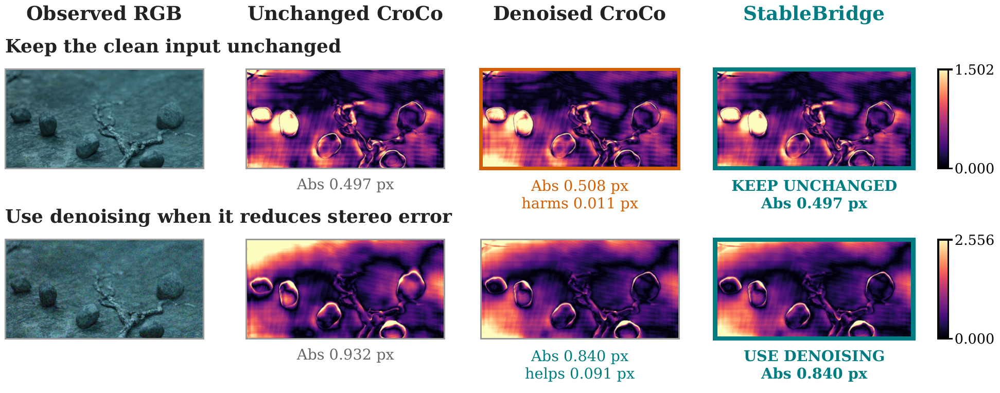
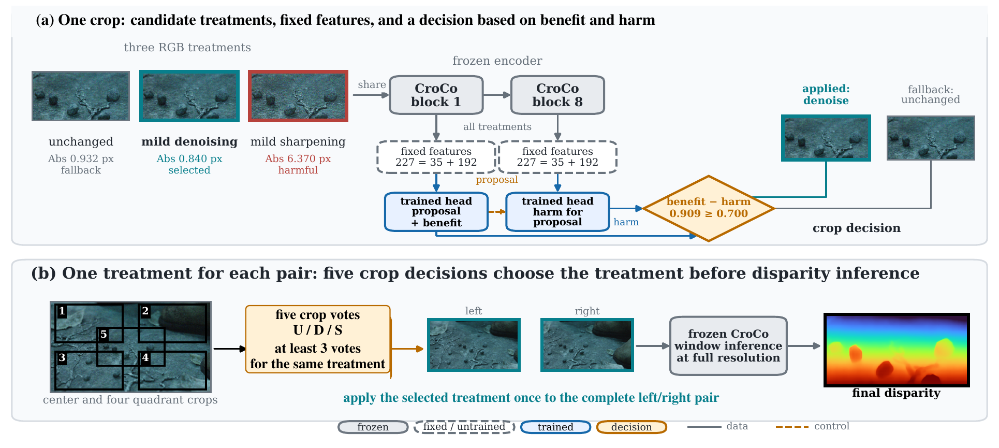

# CroCo-StableBridge: Risk-Aware Input Routing for a Frozen Stereo Matcher

Code for our **NeurIPS 2026 RoCo-Spring Workshop** paper:

[CroCo-StableBridge: Risk-Aware Input Routing for a Frozen Stereo Matcher](docs/paper.pdf)<br>
Shao-Kai Liu, Yun-Tze Tsai and Chih-Chung Hsu



Example from scene 0022, outside the selector's development scenes: denoising
helps the noisy crop and harms its clean counterpart. Error maps share a color
scale within each row.

## Method



Early CroCo features propose a treatment; a benefit and harm check accepts it or
keeps the input unchanged. A treatment is applied to the full stereo pair when
at least three of five crops agree.

## Installation

Linux x86_64, Python 3.12.14 and PyTorch 2.6.0+cu124.
Dependencies are pinned in `pyproject.toml` and `requirements.lock`.
OpenCV needs `libGL.so.1` and `libglib-2.0.so.0`.
The commands below also use `git`, `curl` and `unzip`.

Clone the repository and install the environment:

```bash
git clone https://github.com/cactus8603/stablebridge-stereo.git
cd stablebridge-stereo
bash setup.sh
source .venv/bin/activate
export OMP_NUM_THREADS=4 OPENBLAS_NUM_THREADS=4 MKL_NUM_THREADS=4
```

The installer uses `python3.12`; set `PYTHON_BIN` to use another Python 3.12.14
executable. PyTorch includes the CUDA 12.4 runtime and needs a compatible NVIDIA
driver. Run the commands below from this directory.

## Pretrained weights

Download [weights.zip](https://drive.google.com/file/d/1XDp8a5N77kJrabzSdFfXm33w1WJyCLFK/view)
from Google Drive and extract it from the project directory:

```bash
unzip /path/to/weights.zip
```

This installs the CroCo checkpoint, fixed evidence module and six selector
heads under `weights/`.

## Data

`data/training_features.npz` contains features and targets for 8,784 examples
from 144 pairs in 36 Spring scenes. `data/heldout_predictions.npz` contains
six-fold scene-held-out outputs for calibration and evaluation. Both can be used
without raw images. Samples and folds are in `configs/samples.jsonl`; all training,
pretraining, fine-tuning and validation data are listed in [DATASETS.md](DATASETS.md).

For submission inference, download the Spring and RobustSpring test images:

```bash
python download.py --root /data/stereo --dataset spring-test --workers 1
python download.py --root /data/stereo --dataset robustspring --workers 1
export SPRING_TEST=/data/stereo/datasets/spring/extracted/spring/test
export ROBUST_TEST=/data/stereo/datasets/robustspring/extracted/robust_spring
```

`SPRING_TEST` contains `<scene>/frame_left/` and `<scene>/frame_right/`.
`ROBUST_TEST` contains `<corruption>/test/<scene>/frame_<camera>/`.
Archive URLs and sizes are in `configs/datasets.json`. Downloaded ZIPs are deleted
after extraction; use a dedicated download directory.

## Inference

Run one clean pair:

```bash
python predict.py --mode clean --limit-pairs 1 --output-root runs/preview \
  --clean-test-root "$SPRING_TEST" --robust-test-root "$ROBUST_TEST"
```

Inputs are 1080 × 1920 RGB stereo pairs. Both reference views are predicted as
float32 `.dsp5` files with HDF5 `/disparity` shape `(1080,1920,1)`.
CroCo runs in FP32 with 352 × 704 tiles and overlap 0.9; selector encoding uses
BF16. Selector settings are in `weights/model.json`.

The default batch size is four pairs; use `--batch-pairs 1` to reduce memory.
Clean pairs must select the identity treatment or inference stops.

## Evaluation

Evaluate the supplied scene-held-out crop predictions on CPU:

```bash
python evaluate.py --output runs/evaluation.json
python -m pytest -q tests
```

| Input | CroCo Abs (px) | StableBridge Abs (px) |
| --- | ---: | ---: |
| Clean | 0.684384 | 0.684384 |
| Corrupted | 2.724254 | 2.585896 |

The corrupted error reduction is 5.079%, with a 95% scene-resampling interval of
3.600%–6.567%. These are six-fold results with fitted models, thresholds and
decisions held fixed during scene resampling. To evaluate a new cross-validation
run, pass its `heldout_predictions.npz` with `--predictions` and the matching
feature file with `--data`.

## Training

### Selector heads

Reproduce the six outer folds and their inner-fold threshold calibration, then
fit the six deployment heads on all development scenes:

```bash
python train.py --stage cross-validation --output runs/fitting --device cuda
python train.py --stage final --evaluation runs/fitting/heldout_predictions.npz \
  --output runs/model --device cuda
```

For a deployment-head refit using the supplied calibration, skip the first
command and omit `--evaluation` in the second.
The heads use CroCo blocks 1 and 8 with seeds 17, 43 and 89. Training uses
80 epochs, width 128, batch size 512, AdamW at learning rate 0.001 and weight
decay 0.001, cosine decay and gradient clipping at 5. CroCo and the evidence
module stay frozen. The loss is in `stablebridge/optimization.py`.

Both stages also support `--device cpu`. Repeat the same command to resume
training; resource measurements are saved in `resources.json`.

### Features and targets

To rebuild the training data from Spring images and left disparity:

```bash
python download.py --root /data/stereo --dataset spring-train --workers 1
export SPRING_ROOT=/data/stereo/datasets/spring/extracted/spring
python prepare.py --dataset-root "$SPRING_ROOT" --output runs/training_features.npz
```

Preparation requires CUDA and can resume. Add `--data runs/training_features.npz`
to both training commands above, using new output directories and the resulting
cross-validation predictions for final fitting.

## Submission

Generate all clean and corrupted predictions, then pack them with the included
official Linux x86_64 tools:

```bash
python predict.py --mode all --output-root runs/predictions \
  --clean-test-root "$SPRING_TEST" --robust-test-root "$ROBUST_TEST"
python package_submission.py --predictions-root runs/predictions \
  --clean-test-root "$SPRING_TEST" --robust-test-root "$ROBUST_TEST" \
  --output-dir runs/submission --mode all --execute
```

Submit `runs/submission/disp1_submission.hdf5` for clean test and
`runs/submission/disp1_robustness.hdf5` for robustness. Robustness packing requires
all 21 conditions, including clean: 21,000 pairs and 42,000 disparity maps.
Omit `--execute` to check coverage and format before packing.

Repeat the prediction command to resume. Use a new output directory if the
model, input data, batch size or software changes. To use refitted heads, add
`--bundle runs/model/model.json` to both commands.

## Compute

Each stage can run on one RTX 3090 (24 GiB). Full-resolution FP32 CroCo inference
used 6.821 GiB peak allocated memory with four pairs per batch. Training times,
measurement conditions and CPU/storage requirements are in [COMPUTE.md](COMPUTE.md).

## Citation

```bibtex
@misc{liu2026crocostablebridge,
  title={CroCo-StableBridge: Risk-Aware Input Routing for a Frozen Stereo Matcher},
  author={Liu, Shao-Kai and Tsai, Yun-Tze and Hsu, Chih-Chung},
  year={2026},
  howpublished={RoCo-Spring Workshop, NeurIPS 2026},
  url={https://github.com/cactus8603/stablebridge-stereo/blob/main/docs/paper.pdf}
}
```

## Acknowledgements

This code uses [CroCo](https://github.com/naver/croco). Its code and weights retain
the upstream terms in [LICENSE](vendor/croco/LICENSE),
[NOTICE](vendor/croco/NOTICE) and
[NOTICE_CHECKPOINTS](vendor/croco/NOTICE_CHECKPOINTS).
Dataset terms are linked in [DATASETS.md](DATASETS.md).
